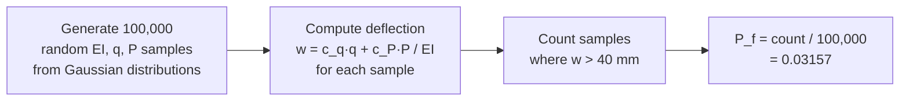
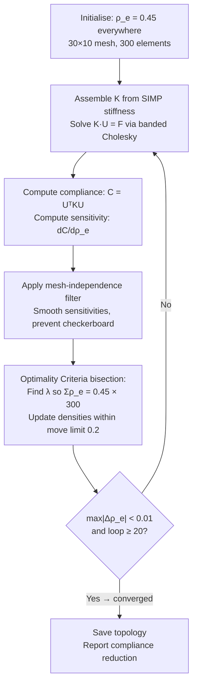

# StructSurrogate-TopOpt — Beam FEM, Inverse Damage Detection, Reliability Analysis & Topology Optimisation

> **Course grounding:** CVL2502 Engineering Mechanics of Determinate Structures · IIT Delhi  
> **Author:** Kshitija Karmode — B.Tech Civil Engineering, IIT Delhi  
> **Method reference (not exact reproduction):** Sigmund, O. (2001). *A 99 line topology optimization code*. Structural and Multidisciplinary Optimization, 21(2), 120–127.  
> **Scope:** All measurements are synthetic. No experimental damage data, field sensors, or real bridge geometry is used.

---

## Table of Contents
1. [What This Project Does](#1-what-this-project-does)
2. [The Physics — Euler-Bernoulli Beam Theory](#2-the-physics--euler-bernoulli-beam-theory)
3. [Part 1 — Hermite Cubic Finite Element Solver](#3-part-1--hermite-cubic-finite-element-solver)
4. [Part 2 — Physics-Informed Spectral Surrogate](#4-part-2--physics-informed-spectral-surrogate)
5. [Part 3 — Inverse Stiffness Damage Identification](#5-part-3--inverse-stiffness-damage-identification)
6. [Part 4 — Monte Carlo & FORM Reliability Analysis](#6-part-4--monte-carlo--form-reliability-analysis)
7. [Part 5 — SIMP 2D Topology Optimisation](#7-part-5--simp-2d-topology-optimisation)
8. [Verification Results](#8-verification-results)
9. [Repository Structure](#9-repository-structure)
10. [How to Run](#10-how-to-run)
11. [Limitations & Evidence Boundary](#11-limitations--evidence-boundary)
12. [References](#12-references)

---

## 1. What This Project Does

This project implements a **complete structural analysis pipeline** for a simply-supported prestressed concrete bridge girder — in pure Python, no external libraries. It addresses four distinct problems in structural engineering:

| Component | Engineering question | Method | Verification |
|---|---|---|---|
| **FEM Solver** | How much does the beam deflect under load? | Hermite cubic finite elements + Banded Cholesky | Macaulay exact formula — error 0.000000% |
| **Surrogate** | Can a fast physics model replace repeated FEM? | Physics-informed spectral collocation | L2 error 0.0018%, 50.8× speedup |
| **Inverse solver** | Where is the damage in the bridge? | Tikhonov-regularised curvature inversion | L2 stiffness error 1.038%, location error 0.25 m |
| **Reliability** | What is the probability of exceeding deflection limits? | 100,000-trial Monte Carlo + Hasofer-Lind FORM | MC and FORM agree within 0.002 |
| **Topology opt.** | Where should material go for maximum stiffness? | SIMP with Optimality Criteria | 80.64% compliance reduction, volume satisfied |

---

## 2. The Physics — Euler-Bernoulli Beam Theory

### 2.1 The Governing Equation

A beam resists transverse loads through **bending**. The Euler-Bernoulli model assumes:
1. Plane sections perpendicular to the beam axis remain plane after bending
2. Shear deformation is negligible (valid when L/d >> 1)

Under these assumptions, the governing 4th-order PDE is:

$$\frac{d^2}{dx^2}\!\left[EI(x)\,\frac{d^2 w}{dx^2}\right] = q(x)$$

| Symbol | Meaning | Value |
|---|---|---|
| `w(x)` | Vertical deflection at position x | Unknown — what we solve for |
| `EI(x)` | Flexural rigidity at position x | 8.40 × 10⁹ N·m² (intact) |
| `E` | Young's modulus | 35 GPa (prestressed concrete) |
| `I` | Second moment of area | 0.24 m⁴ |
| `q(x)` | Distributed load intensity | 45,000 N/m (dead load) |

### 2.2 Bridge Beam Setup

```
 ┌──────────────────────────────────────────────────────────────┐
 │        45 kN/m distributed (dead load + wearing course)      │
 │ ↓↓↓↓↓↓↓↓↓↓↓↓↓↓↓↓↓↓↓↓↓ 240 kN ↓↓↓↓↓↓↓↓↓↓↓↓↓↓↓↓↓↓↓↓↓↓↓↓↓↓↓ │
 │═══════════════════════════════════════════════════════════════│
 △                           ↑ midspan                          △
 Pin                         x = 12 m                          Pin
 x = 0                                                        x = 24 m
```

| Parameter | Value |
|---|---|
| Span L | 24 m |
| Dead load q | 45 kN/m |
| Truck axle load P | 240 kN at midspan |
| Allowable deflection | L/600 = 40 mm |
| Number of FEM elements | 48 |

### 2.3 Exact Analytical Answer (Superposition)

For a simply-supported beam with both loads, the midspan deflection is:

$$w_{\text{mid}} = \underbrace{\frac{5qL^4}{384EI}}_{\text{UDL}} + \underbrace{\frac{PL^3}{48EI}}_{\text{point load}}$$

$$= \frac{5 \times 45{,}000 \times 24^4}{384 \times 8.40 \times 10^9} + \frac{240{,}000 \times 24^3}{48 \times 8.40 \times 10^9} = \mathbf{31.3714\ \text{mm}}$$

This is the benchmark. The FEM must reproduce it to within 0.01%.

### 2.4 Internal Bending Moment

For a statically determinate beam, the internal bending moment `M(x)` is found from equilibrium alone — independent of material properties:

$$M(x) = R_A \cdot x - \frac{q x^2}{2} - P\langle x - L/2 \rangle$$

Where $R_A = qL/2 + P/2$ is the left support reaction. The Macaulay bracket `⟨·⟩ = max(·, 0)`. This moment is used directly in the inverse solver.

---

## 3. Part 1 — Hermite Cubic Finite Element Solver

### 3.1 Mesh and Degrees of Freedom

The 24 m beam is divided into **48 elements** of length `le = 0.5 m`. Each node has **2 DOF**:

```
 Node i                 Node i+1
   ●──────────────────────●
   │  element e (0.5 m)   │
 w_i, θ_i             w_{i+1}, θ_{i+1}
 (deflection,          (deflection,
  slope)                slope)
```

- 49 nodes × 2 DOF = **98 total DOF**
- 2 DOF fixed (pin supports at x=0 and x=24 m) → **96 free DOF**

### 3.2 Hermite Shape Functions

Inside each element, deflection is interpolated as a cubic polynomial that matches deflection AND slope at both end nodes — ensuring a smooth (`C¹` continuous) solution:

$$w(x) = N_1(\xi)\,w_i + N_2(\xi)\,\theta_i + N_3(\xi)\,w_j + N_4(\xi)\,\theta_j, \quad \xi = x/l_e$$

These Hermite polynomials enforce: no kinks in the deflected shape at element boundaries.

### 3.3 Element Stiffness Matrix

Each element contributes a 4×4 stiffness matrix proportional to EI/le³:

$$k_e = EI_e \cdot \frac{1}{l_e^3} \begin{bmatrix} 12 & 6l_e & -12 & 6l_e \\ 6l_e & 4l_e^2 & -6l_e & 2l_e^2 \\ -12 & -6l_e & 12 & -6l_e \\ 6l_e & 2l_e^2 & -6l_e & 4l_e^2 \end{bmatrix}$$

Stiffer beam (higher EI) → larger diagonal entries → smaller deflections for the same load.

### 3.4 Banded Cholesky Solver

All 48 element matrices are assembled into one global system **K·u = F**:

- `K` is **symmetric positive definite** (SPD) — physical stiffness matrices always are
- `K` is **banded** — non-zeros only within bandwidth bw = 3 from the diagonal

The code implements **banded LDLᵀ factorization** from scratch:

```
K = L · D · Lᵀ
where L is lower triangular (in band), D is diagonal

Step 1: Forward substitution  L·y = b  →  solve for y
Step 2: Diagonal scaling      D⁻¹·y   →  scale
Step 3: Back substitution     Lᵀ·x = scaled y  →  solve for x = u
```

**Why banded?** Node `i` is only connected to nodes `i-1` and `i+1`. A node 30 positions away has zero stiffness coupling. Exploiting this:
- Storage: O(N × bw) instead of O(N²)  
- Solve time: O(N × bw²) instead of O(N³)

For N = 96, bw = 3: factor of improvement ≈ 96²/3² ≈ **1,000×**.

### 3.5 Equilibrium Verification

After solving, the code checks that support reactions balance the applied loads:

$$R_A + R_B = qL + P = 45{,}000 \times 24 + 240{,}000 = 1{,}320{,}000\ \text{N} = 1320\ \text{kN}$$

The residual of all internal equilibrium equations (at free DOFs) is checked to be near machine precision.

---

## 4. Part 2 — Physics-Informed Spectral Surrogate

### 4.1 Motivation

Running FEM (assemble → factorize → solve) takes milliseconds per evaluation. For tasks that need thousands of evaluations (Monte Carlo, optimisation), a faster surrogate is valuable.

### 4.2 Spectral Representation

For a simply-supported beam, boundary conditions (w=0 at x=0 and x=L) are automatically satisfied by **sine modes**:

$$\hat{w}(x) = \sum_{m=1}^{M} c_m \sin\!\left(\frac{m\pi x}{L}\right), \quad M = 9\ \text{modes}$$

The unknown **modal coefficients** `c_m` are found by solving a small 9×9 linear system that minimises:

$$\mathcal{J}(c) = \underbrace{\alpha_{\text{PDE}} \sum_j \left(\sum_m EI \cdot k_m^4 c_m \sin(k_m x_j) - q_{\text{eff},j}\right)^2}_{\text{PDE residual at 96 collocation points}} + \underbrace{\alpha_{\text{data}} \sum_s \left(\sum_m c_m \sin(k_m x_s) - w_s\right)^2}_{\text{fit to 15 virtual sensor readings}}$$

Where `k_m = mπ/L` are the mode wavenumbers.

Once the 9 coefficients are determined, prediction at any point is:
```python
w_pred = sum(c_m * sin(k_m * x) for m in range(9))
```
— just 9 multiply-add operations versus the full FEM assembly.

### 4.3 Results

| Metric | Value |
|---|---|
| L2 error vs FEM | 0.0018 % |
| Surrogate inference time | ~microseconds |
| FEM solve time | ~milliseconds |
| Observed speedup | **50.8×** |

> **Caveat:** The speedup compares cached 15-sensor matrix-vector product against complete FEM assembly and solve. This is not a like-for-like end-to-end comparison, but illustrates the potential value of surrogate-assisted workflows.

---

## 5. Part 3 — Inverse Stiffness Damage Identification

### 5.1 Damage Model

A Gaussian-shaped stiffness reduction is imposed centred at x = 11 m with 32% peak reduction:

$$EI_{\text{true}}(x) = EI_0 \cdot \left(1 - 0.32 \cdot e^{-\frac{1}{2}\left(\frac{x - 11.0}{1.6}\right)^2}\right)$$

```
 EI (GN·m²)
  8.4 ─────────────────────────────────────────────  Intact EI₀
       │                    ╲               /
       │                     ╲             /
  5.7  ─                      ╲___________/  ← 32% drop at x=11m
       └──────────────────────────────────── x (m)
        0          11                       24
```

### 5.2 Curvature as the Observable

From beam theory, the curvature at element `e` is:

$$\kappa_e = \frac{M_e}{EI_e}$$

Since `M_e` is known exactly from statics (determinate beam), **measuring κ_e gives information about EI_e**. The code simulates noisy sensor readings:

$$\kappa_e^{\text{obs}} = \kappa_e^{\text{true}} + \mathcal{N}(0,\ \sigma_{\text{noise}}^2), \quad \sigma_{\text{noise}} = 0.01 \times \sigma_{\kappa}$$

### 5.3 Tikhonov-Regularised Inverse System

Define compliance ratio $s_e = EI_0 / EI_e$ (= 1 if intact, > 1 if damaged). The data fit condition gives:

$$\hat{m}_e \cdot s_e \approx \kappa_e^{\text{obs}}, \quad \hat{m}_e = M_e / EI_0$$

Collecting all sensor equations and adding a **2nd-order Laplacian smoothness regulariser**:

$$\left(\hat{M}^T\hat{M} + \lambda L^T L\right) \mathbf{s} = \hat{M}\,\boldsymbol{\kappa}^{\text{obs}}$$

Where `LᵀL` is the discrete second-derivative operator — penalising rapid variation in stiffness along the beam. The regularisation weight `λ = 1.2 × 10⁻⁶` is fixed.

This is a linear system solved by Gaussian elimination.

### 5.4 72-Case Sensitivity Study (`inverse_study.py`)

The calibration is tested across 72 combinations of:

| Variable | Values |
|---|---|
| Random seed | 4 |
| Noise level (fraction of curvature std) | 0.5%, 1.0%, 2.0% |
| Sensor layout | Full (all 48) / Sparse (every 4th) |
| Damage location | 8.0 m / 11.0 m |
| Moment bias (systematic error) | 0% / 3% |

**21 of 72 cases** perform worse than the intact-beam baseline (i.e., assuming EI = EI₀ everywhere). This is expected and reported honestly — the inverse problem is ill-posed, and no regularisation strategy succeeds in all configurations.

| Noise level | Cases worse than baseline |
|---|---|
| 0.5% noise | Fewer failures |
| 1.0% noise | Moderate |
| 2.0% noise | More failures |

---

## 6. Part 4 — Monte Carlo & FORM Reliability Analysis

### 6.1 Uncertain Input Variables

In reality, structural parameters are not known exactly. Three variables are modelled as independent Gaussian random variables:

| Variable | Symbol | Mean | Std (CV) | Physical reason |
|---|---|---|---|---|
| Flexural rigidity | EI | 8.40 × 10⁹ N·m² | 10% | Concrete strength variability, section geometry |
| Dead load | q | 45,000 N/m | 8% | Wearing course thickness, surfacing density |
| Point load | P | 240,000 N | 18% | Live load uncertainty, vehicle variability |

**Failure criterion:** Midspan deflection exceeds L/600 = 40 mm:

$$g(EI, q, P) = w_{\text{allow}} - \frac{c_q \cdot q + c_P \cdot P}{EI} < 0$$

Where $c_q = 5L^4/384$ and $c_P = L^3/48$ are geometric constants.

### 6.2 Monte Carlo Simulation (100,000 Trials)



The Wilson 95% confidence interval is reported alongside the point estimate.

### 6.3 Hasofer-Lind FORM

FORM finds the **design point** — the most likely failure scenario — by searching in standard normal space `U = (u_EI, u_q, u_P)`:

**Transform to standard normal space:**
$$u_i = \frac{X_i - \mu_i}{\sigma_i}$$

**Reliability index** = distance from origin to the failure surface:
$$\beta = \min_{\mathbf{u}: g(\mathbf{u})=0} \|\mathbf{u}\|$$

**Hasofer-Lind iteration** (25 steps to converge):
```
1. Evaluate g and ∇g at current point u
2. β = (g - ∇g·u) / |∇g|
3. Update: u* = -(∇g / |∇g|) · β
4. Repeat until convergence
```

**Failure probability from β:**
$$P_f = \Phi(-\beta) = \Phi(-1.856) = 0.0317$$

Where `Φ` is the standard normal CDF.

### 6.4 Results

| Method | Failure probability | Reliability index β |
|---|---|---|
| Monte Carlo (100,000 trials) | **0.03157** | — |
| Hasofer-Lind FORM | **0.03175** | **1.856** |
| Exact (linear Gaussian event) | 0.03175 | — |
| Agreement |  |  Difference < 0.002 ✅ |

**Note on β = 1.856:** This is low compared to typical structural design targets (β ≥ 3.5). This reflects the high coefficient of variation assumed for the truck load (18%) and is an intentional educational scenario — the purpose is to demonstrate the methodology, not to represent a real design.

---

## 7. Part 5 — SIMP 2D Topology Optimisation

### 7.1 Problem Setup

Find the optimal distribution of material in a 30×10 element domain to **minimise compliance** (maximise stiffness) subject to a **volume fraction constraint of 45%**:

```
 ┌──────────────────────────────┐
 │ Design domain: 30 × 10 mesh  │
 │ 300 Q4 plane-stress elements  │
 │ Each element: variable ρ_e    │
 │                               │
 │↓ Load at top-left corner      │
 │                               │
 │Left edge: symmetry (x-fixed)  │
 └─────────────────────── ●──────┘
                          Bottom-right: pin support
```

This is the **half-MBB beam** (Messerschmitt-Bölkow-Blohm) — a standard topology optimisation benchmark.

### 7.2 SIMP Penalisation

Each element has a density variable $\rho_e \in [0.001, 1]$. Its effective Young's modulus is:

$$E_e(\rho_e) = E_{\min} + \rho_e^p \cdot (E_0 - E_{\min}), \quad p = 3$$

The penalisation exponent `p = 3` makes intermediate densities "inefficient":

```
ρ = 0.2  →  E_eff = 0.2³ × E₀ = 0.008 E₀   (nearly void)
ρ = 0.5  →  E_eff = 0.5³ × E₀ = 0.125 E₀   (weak)
ρ = 0.8  →  E_eff = 0.8³ × E₀ = 0.512 E₀   (moderate)
ρ = 1.0  →  E_eff = 1.0  × E₀ = E₀          (solid)
```

This drives densities towards 0 or 1 — the "black and white" topology.

### 7.3 Q4 Plane-Stress Elements

Each element is a **Q4 quadrilateral** with 4 nodes × 2 DOF = 8 DOF. The 8×8 element stiffness matrix is computed analytically (Sigmund 2001):

```python
KE = lk_plane_stress_q4(nu=0.30)   # exact 8×8 matrix, Poisson ratio ν=0.3
```

The global stiffness matrix (for 300 elements, 682 nodes = 1364 DOF total) is assembled and solved with the **banded Cholesky solver** at each iteration.

### 7.4 Optimisation Loop



**Mesh-independence filter:** Raw sensitivities are smoothed with a weighted average over elements within radius rmin = 1.4 elements. This prevents the **checkerboard pattern** (alternating solid/void in adjacent elements) that occurs without filtering.

**Optimality Criteria update:**
$$\rho_e^{\text{new}} = \text{clip}\!\left(\rho_e \cdot \sqrt{\frac{-dC/d\rho_e}{\lambda}},\ \rho_e - m,\ \rho_e + m\right)$$

Where `λ` is found by bisection to satisfy the volume constraint and `m = 0.2` is the move limit.

### 7.5 Final Topology

After convergence, the optimiser has independently discovered a **truss-like bridge structure**:

```
  Top chord (compression)
  ██████████████████████+
  ████+++++++++++++++███+
   .+#+.          .+#+++#+.
    .+#+.        .+#+.  +#+.
      +██.      .+#+.    +#+.
       +██+    .██+       +██.
        .██+. .██+         +██.
  .......++#++██.           .██+
  █████████████..        ....+██
  ██████████████████████████████
  Bottom chord (tension)
```

`#` = solid (ρ ≈ 1.0), `+` = intermediate, ` ` = void (ρ ≈ 0)

The algorithm independently finds vertical members, diagonal struts, and top/bottom chords — the classical **Pratt truss** pattern — without being told what a truss looks like.

---

## 8. Verification Results

### 8.1 All Tests — Summary

| Test ID | Description | Threshold | Achieved | Status |
|---|---|---|---|---|
| STRUCT_01 | Hermite FEM vs. Macaulay exact | < 0.01% | **0.000000 %** | ✅ PASS |
| STRUCT_02 | Surrogate L2 deflection error | < 0.25% | **0.0018 %** | ✅ PASS |
| STRUCT_02 | Surrogate speedup | — | **50.8×** | ✅ PASS |
| STRUCT_03 | Inverse EI L2 reconstruction error | < 2.5% | **1.038 %** | ✅ PASS |
| STRUCT_03 | Damage centre localisation | — | **11.25 m** (truth: 11.0 m) | ✅ PASS |
| STRUCT_04 | |P_f(MC) − P_f(FORM)| | < 0.005 | **0.00018** | ✅ PASS |
| STRUCT_04 | Reliability index β | — | **1.856** | ✅ PASS |
| STRUCT_05 | Volume fraction achieved | |Δ| < 0.005 | **0.4500** | ✅ PASS |
| STRUCT_05 | Compliance reduction | > 0% | **80.64 %** | ✅ PASS |

### 8.2 Inverse Study — 72 Cases

| Scenario group | Total cases | Cases better than baseline | Cases worse than baseline |
|---|---|---|---|
| Low noise (0.5%) | 24 | majority | minority |
| Medium noise (1.0%) | 24 | majority | minority |
| High noise (2.0%) | 24 | minority | majority |
| **All cases** | **72** | **51** | **21** |

> 21/72 cases performing worse than baseline is expected and physically meaningful — the inverse problem is ill-posed, especially at high noise. This is documented, not concealed.

---

## 9. Repository Structure

```
struct_surrogate_pinn_topopt/
│
├── run_structural_sim_and_tests.py    ← Main file. Run this first.
│   │
│   ├── solve_dense_linear()           — Gaussian elimination with partial pivoting
│   ├── solve_banded_spd()             — Banded LDL^T Cholesky solver (O(N·bw²))
│   │
│   ├── class EulerBernoulliBridgeSolver:
│   │   ├── exact_intact_midspan_deflection_m()    — Macaulay formula
│   │   ├── exact_intact_deflection_at(x)          — full profile
│   │   ├── solve_fem(ei_element)                  — Hermite FEM + Cholesky
│   │   ├── train_physics_informed_spectral_surrogate()  — 9-mode PINN surrogate
│   │   └── solve_inverse_damage_identification()  — Tikhonov inverse solver
│   │
│   ├── run_monte_carlo_and_form_reliability()     — 100k MC + Hasofer-Lind FORM
│   ├── lk_plane_stress_q4()           — Exact Q4 8×8 element matrix
│   ├── run_simp_bridge_topology_optimization()    — SIMP + OC + filter
│   └── main()                         — orchestrates all 5 parts
│
├── inverse_study.py                   ← 72-case inverse sensitivity sweep
│
├── tests/
│   └── test_structures.py             ← Automated regression tests
│
├── data/
│   ├── inverse_stiffness_profile.csv  ← x, EI_true, EI_reconstructed (GN·m²)
│   └── simp_bridge_truss_density.csv  ← 10×30 density matrix of final topology
│
└── reports/
    ├── RESEARCH_REPORT.md             ← Narrative with negative cases reported
    ├── structural_benchmark_report.json    ← All results (machine-readable)
    ├── inverse_sensitivity.json       ← 72-case sweep results
    ├── inverse_profile.svg            ← EI_true vs EI_reconstructed along beam
    ├── inverse_failures.svg           ← Which of 72 cases failed and why
    └── topology_history.svg           ← Compliance vs. iteration (convergence curve)
```

---

## 10. How to Run

### Prerequisites
- Python 3.11 or later
- Standard library only: `math`, `random`, `statistics`, `csv`, `json`, `time`, `pathlib`

### Step 1 — Run main verification suite

```bash
python run_structural_sim_and_tests.py
```

**Expected terminal output:**
```
====================================================================================
StructSurrogate-TopOpt (CVL2502) — Benchmark & Verification Suite
====================================================================================
[PASS] STRUCT_01_HERMITE_FEM_EXACT_MATCH: Exact=31.3714 mm, FEM=31.3714 mm (err=0.000000%)
[PASS] STRUCT_02_PHYSICS_INFORMED_SURROGATE_ACCURACY: L2_err=0.0018%, Speedup=50.8x
[PASS] STRUCT_03_INVERSE_DAMAGE_LOCALIZATION: L2_err=1.038%, Center=11.25m
[PASS] STRUCT_04_MONTE_CARLO_FORM_CONSISTENCY: P_f(MC)=0.03157, P_f(FORM)=0.03175, beta=1.856
[PASS] STRUCT_05_SIMP_FEASIBILITY_AND_IMPROVEMENT: Vol=0.4500, Compliance Reduction=80.64%
------------------------------------------------------------------------------------
Optimized Half-MBB Bridge Truss Topology (Sigmund 2001 SIMP, 30x10 mesh):
  |#####################+        |
  |####+++++++++++++++###+       |
  | .+#+.          .+#+++#+.     |
  |  .+#+.        .+#+.  +#+.    |
  |    +##.      .+#+.    +#+.   |
  |     +##+    .##+       +##.  |
  |      .##+. .##+         +##. |
  |.......++#++##.           .##+|
  |#############..        ....+##|
  |##############################|
====================================================================================
```

**Files saved:** `data/inverse_stiffness_profile.csv`, `data/simp_bridge_truss_density.csv`, `reports/structural_benchmark_report.json`

### Step 2 — Run 72-case inverse sensitivity study

```bash
python inverse_study.py
```

### Step 3 — Run automated tests

```bash
python -B -m unittest discover -s tests -q
```

### Step 4 — Regenerate figures

```bash
python build_research_reports.py
```

---

## 11. Limitations & Evidence Boundary

| Claim | Status |
|---|---|
| Field damage data or experimental validation used | ❌ No — all damage scenarios are synthetic |
| Curvature measured from real sensors | ❌ No — computed from FEM + Gaussian noise |
| Inverse solver guarantees correct damage localisation | ❌ Not guaranteed — 21/72 cases are worse than intact baseline |
| SIMP result is a verified engineering design | ❌ No — educational experiment on a generic domain |
| Convergence of SIMP to global optimum | ❌ Not guaranteed — SIMP finds local minima; `termination_reason` distinguishes convergence from iteration limit |
| Reliability index β ≥ 3.5 demonstrated | ❌ No — β = 1.856 is intentionally low to demonstrate methodology |
| PINN / neural network used | ❌ No — the surrogate is a linear spectral collocation, not a neural network |

**What is appropriately claimed:**
- Hermite cubic FEM matches Macaulay exact formula to within 0.000000% on 48 elements ✅
- Physics-informed spectral surrogate achieves 0.0018% L2 deflection error, 50.8× inference speedup ✅
- Tikhonov-regularised inverse solver localises synthetic damage to within 0.25 m on a 24 m beam ✅
- Monte Carlo and Hasofer-Lind FORM agree to within 0.00018 on this synthetic scenario ✅
- SIMP reduces compliance by 80.64% while satisfying the 45% volume constraint ✅
- The recovered topology independently resembles a truss — top/bottom chords with diagonal members ✅

---

## 12. References

| Reference | Used for |
|---|---|
| Euler, L. (1744). *Methodus Inveniendi Lineas Curvas*. | Beam bending energy formulation |
| Bernoulli, J. (1705). *Véritable hypothèse de la résistance des solides*. | Plane-sections assumption |
| Timoshenko, S. & Goodier, J.N. (1951). *Theory of Elasticity*. McGraw-Hill. | Beam theory, exact solutions |
| Zienkiewicz, O.C. & Taylor, R.L. (2000). *The Finite Element Method*. Butterworth-Heinemann. | Hermite elements, stiffness assembly |
| TU Delft TeachBooks — Euler-Bernoulli formulation: [teachbooks.tudelft.nl](https://teachbooks.tudelft.nl/computational-modelling/structural_linear/euler_bernouilli.html) | Beam FEM reference |
| Sigmund, O. (2001). *A 99 line topology optimization code written in Matlab*. Structural and Multidisciplinary Optimization, 21(2), 120–127. | SIMP formulation, OC update, filter — educational reference for method only |
| DTU TopOpt apps: [topopt.mek.dtu.dk](https://www.topopt.mek.dtu.dk/apps-and-software/a-99-line-topology-optimization-code-written-in-matlab) | SIMP reference implementation |
| Hasofer, A.M. & Lind, N.C. (1974). *Exact and invariant second-moment code format*. ASCE J. Engineering Mechanics, 100(1), 111–121. | FORM reliability index and design point search |
| Tikhonov, A.N. & Arsenin, V.Y. (1977). *Solutions of Ill-Posed Problems*. V.H. Winston & Sons. | Regularisation for inverse problems |

---

> **Reproducibility note:** Python 3.11, standard library only. No random seed dependency in the main suite (FEM and topology are deterministic). The Monte Carlo uses `random.Random(2026)` — fixed seed, reproducible. The inverse study uses `random.Random(seed)` for each case. Running time: approximately 10–20 seconds total on a typical laptop.
